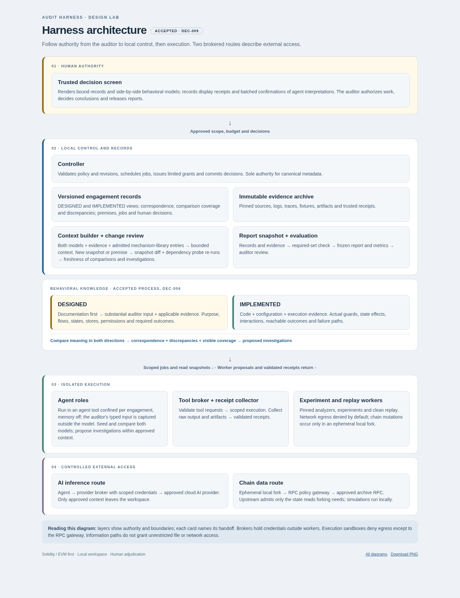

# Human led EVM audit harness proposal

Status: **architecture accepted as amended**, 2026-10-12, in [DEC-009](../decisions/DEC-009-architecture-acceptance-and-remaining-dispositions.md); proposed 2026-10-01. Author: **Codex**. [DEC-002](../decisions/DEC-002-harness-operating-envelope.md) accepts Solidity/EVM first, small auditor-approved investigation batches, and a local workspace with approved cloud AI providers. [DEC-004](../decisions/DEC-004-confirmation-evidence-policy.md) accepts justified alternative evidence for confirmation. [DEC-005](../decisions/DEC-005-comprehension-lensing.md) accepts repeatable state-machine lensing, connected walkthroughs and investigation after broad orientation and review of the relevant flow. [DEC-008](../decisions/DEC-008-adversarial-review-dispositions.md) accepts several further choices:

- agents self-report their scenario changes, an accepted residual risk;
- a broad default attacker charter, with privileged roles trusted;
- evidence requirements scaled to potential impact;
- evidence-first packets for potential High/Critical decisions;
- the auditor's input captured outside the model;
- dependency probes for change handling;
- a walking-skeleton build order.

These were integrated on 2026-10-12 and use the vocabulary of the [glossary](harness-glossary.md). [DEC-009](../decisions/DEC-009-architecture-acceptance-and-remaining-dispositions.md) then accepted this architecture as amended (Q-008) and settled the remaining choices:

- statements from the auditee keep only their origin label, an accepted residual risk;
- a curated cross-engagement mechanism library of public entries and the auditor's sanitized lessons;
- an optional expectations pre-step, with the auditor's intent tagged by when it was recorded;
- method changes adopted on the held-out comparison, an accepted residual risk;
- no urgent-disclosure path;
- follow-ups into another guarantee kept inside the batch as linked variants.

This document and its companions are the [accepted baseline](harness-glossary.md#terms) for the implementer package. Numeric limits and the choice of store, runner, model provider, sandbox and agent host remain proposals. [DEC-001](../decisions/DEC-001-knowledge-and-memory.md) continues to govern the design lab's separate memory.

Build a persistent audit workspace in which one human auditor directs agents toward precise security questions, checks their evidence, and decides what becomes a finding. Organize work around protocol guarantees and value flows. Use hypotheses, property campaigns, and adversarial scenarios as three investigation methods over the same records and execution controls.

The product is an **evidence workbench**: it should make the next useful audit decision easier, preserve why a lead was accepted or rejected, and identify which conclusions need revisiting after a change. Its value is a hypothesis to evaluate, not an established improvement in vulnerability detection.

## Reading guide

| Document | What it specifies |
|---|---|
| This proposal | Product, architecture, roles, auditor workflow, and delivery boundary |
| [Glossary](harness-glossary.md) | Canonical terms, stage numbering, allowed values and the impact-scaled disposition table |
| [State and execution](harness-state-and-execution.md) | Records, transitions, permissions, isolation, recovery, memory, and invalidation |
| [Component and artifact contracts](harness-interface-contracts.md) | Requests, errors, adapter boundaries, reconciliation, export and import behavior |
| [Auditor guide](harness-auditor-guide.md) | Intake through closure, decision packets, exceptions, interruption and interface states |
| [Comprehension lenses](harness-comprehension-method.md) | Accepted lensing requirements, and the state-machine, diagram and exploration mechanics of the baseline |
| [Human/agent workflow and loops](harness-workflow-loops.md) | Accepted scenario authorship and review cadence, eight named loops and their authority/exit conditions |
| [Requirements](harness-requirements.md) | Functional and non-functional requirements with observable acceptance scenarios |
| [Evaluation](harness-evaluation.md) | Evidence quality, pilot design, metrics, and controlled improvement |
| [Research and rationale](../research/harness-design-sprint.md) | Original imported diagrams, selected primary-source checks, new research, alternatives, and limits |
| [New flow review](../research/flow-diagram-review.md) | Two additional flow diagrams, ownership/loop triage and DEC-007 decision rationale |
| [Design dispositions](../decisions/DEC-003-harness-architecture-proposal.md) | The accepted architecture, why, its alternatives, and its amendments in [DEC-008](../decisions/DEC-008-adversarial-review-dispositions.md) and [DEC-009](../decisions/DEC-009-architecture-acceptance-and-remaining-dispositions.md) |
| [Specification completion audit](../research/harness-specification-completeness.md) | Requirement-by-requirement evidence and the boundary between completed documentation and future runtime checks |

## Product boundary

The primary user is one experienced smart contract auditor who owns the engagement's scope, threat model, semantic judgments, findings, and closure. Protocol developers may supply answers and patches through that auditor. A second human review can be recorded when available; several agents do not substitute for one.

Inputs are pinned source and dependencies, intended behavior, deployment/configuration facts, known issues, prior reports, allowed attacker capabilities, time and spending limits, and disclosure constraints. Outputs are confirmation reports, reproducible PoC packages where appropriate, rejected leads with reasons, unresolved concerns, reviewed properties, and revision-specific fix assessments.

Version one covers Solidity source on explicitly identified EVM chains and hardfork semantics. A source-only audit is supported when deployment information is unavailable; its report must state that boundary. Compiler, build-system, proxy, library, assembly, token, oracle, and chain-specific support are checked per engagement. Unsupported behavior becomes a gap. Future ecosystem adapters must supply their own semantic and evidence contracts.

The harness assists manual comprehension, analysis, testing, and reporting. Model training, training-data preparation, live exploitation, production transactions, autonomous final adjudication, and automatic patch merging are outside the initial product. So is urgent disclosure: a credible urgent concern prompts the auditor's attention, any urgent contact with the client happens outside the harness, and the full frozen export is the only release path (DEC-009, Q-025). Remediation work means evaluating a separately supplied patch and optionally drafting recommendations.

## Architecture

[Open the HTML diagram](diagrams/harness-architecture.html). Labeled handoffs show permitted information paths, not unrestricted file or network access. Components may begin as modules in a local application; the diagram does not require a service fleet.

| Component | Responsibility and boundary |
|---|---|
| Auditor interface | Persistent notebook, system model, investigation queue, evidence comparison and export preview. Decisions happen on the trusted decision screen, which renders bound records, records display receipts and takes batched confirmations of agent interpretations. Supports pause, redirect and resume |
| Controller | Sole authority for metadata writes, scheduling, resource reservations, capability grants, decision validation, and state transitions; ordinary program logic, not an LLM agent |
| Engagement store | Versioned semantic records, job/event history, human decisions, dependencies, and report manifests; transactionally consistent metadata |
| Evidence archive | Immutable source snapshots, manifests, logs, traces, fixtures, minimized cases, and replay receipts, addressed by content hash |
| Mechanism library | Curated cross-engagement mechanisms with their counterconditions, from public sources and the auditor's sanitized lessons. Context builders read admitted entries; only `record_transfer` decisions write it, and no entry names its source engagement (DEC-009, Q-022) |
| Context builder | Makes a bounded, versioned packet for each role; includes relevant contradictions and unknowns and records retrieved sources |
| Agent workers | Propose analysis, tasks, experiments, model edits and report prose inside a capability-limited context; cannot approve themselves. They run in an existing agent tool confined per engagement, with host memory off; the auditor's typed input is captured outside the model's control |
| Tool broker and execution workers | Run pinned analyzers and experiments in isolated workspaces; return result receipts and artifacts; no direct mutation of canonical conclusions |
| Provider broker | Holds provider credentials outside workers; sends only approved context through a selected provider policy and accounts for usage |
| Change evaluator | After a source, configuration, premise, property or tool-model change, produces the snapshot diff and re-runs dependency probes. Assigns freshness (`carried_forward_mechanical`, `affected` or `possibly_affected`) and builds the recheck queue |
| Report and evaluation module | Exports a frozen set of decisions and evidence, after checking it against the controller-computed required set; generates the structured report sections from records; measures workload, decision load and gaps using a recorded metric version |

**Initial substrate: a walking skeleton (DEC-008, Q-020).** Build the first version as:

- one local controller process that runs jobs one at a time as child processes it owns;
- append-only, Git-backed records validated against schemas;
- hash-pinned evidence files and receipts from a trusted runner.

It keeps the invariants: agents cannot write canonical records, approvals bind exact revisions, and receipts come from the trusted runner.

The existing agent tool connects through a narrow API under four conditions, from Q-018 and the isolation rules: the auditor's typed input is captured outside the model; the tool is confined per engagement; it runs with its memory off; and its provider calls go through the provider broker, with no raw provider keys in the tool.

A transactional store such as SQLite, a small local runner, LangGraph or Temporal become candidates only when the [deferred-mechanism triggers](harness-state-and-execution.md#deferred-mechanisms) are met. Any selection still waits for the [recovery scenarios](harness-evaluation.md#control-and-recovery-scenarios). Workflow checkpoints cannot be the only authority for audit decisions.

**Initial tool recommendation:** use the target's pinned compiler/build configuration and its artifacts for the deterministic scope inventory and storage layouts. Use Slither for structural queries, dependency probes and candidate signals, and Foundry/Anvil for local experiments, the project's own test suite with coverage, and replay. Diff vendored or forked code against its upstream release. Check interfaces and supported versions before integration. Add Echidna, Medusa, Halmos, or a formal verifier when a selected question warrants it. Vendor scanners enter as attributed candidate sources with exportable raw results, not as independent adjudicators. These are documented capability precedents, not integrations validated by this sprint. [Primary-source register](../kb/sources.md#sprint-primary-sources).

Use a curated control checklist as an omission review alongside protocol-specific guarantees. For each relevant control, record applicability, examined evidence, exclusions and outstanding gaps. OWASP supplies linked verification and testing resources, but checking off controls does not establish whole-protocol security. [OWASP SCSVS](https://scs.owasp.org/SCSVS/).

## Agent role classification

Roles are reusable task profiles with different context and tool grants. They need not be different models or always-on processes. Start with the few roles needed for the current batch; compare their contribution before increasing concurrency.

| Role | Receives | Produces | May not decide |
|---|---|---|---|
| Intake and comprehension agent | Snapshot, documents, structural queries | Assets, actors, states, flow maps, intent/implementation differences, unresolved premises | That developer intent or its own summary is correct |
| Planning assistant | Current model, coverage gaps, lead-generator coverage, unresolved leads, remaining budget | Ranked investigation questions and a proposed batch, including a less-explored area and at least one high-value multi-step or cross-flow question | Scope expansion, new permissions, or the batch budget |
| Investigator | One investigation question, the engagement's attacker charter, local code plus every writer of the storage it reads, and relevant evidence | Causal claim, counterconditions, scenario variants with outcomes, declared setup powers, trace, and cheapest useful next check | Finding validity, final severity, or dismissal of competing evidence |
| Property and experiment agent | Selected question and reviewed semantics | Versioned fixtures, handlers, reference models, test artifacts and adequacy notes | A changed oracle, narrower attack model, or edited production target |
| Challenger | Same authoritative snapshot and reviewed premises; initially no author's narrative and no provisional statements on the challenged path; optionally comments and NatSpec stripped | Independent prerequisite check, review of declared setup powers, counterargument, missing evidence; then artifact review. Output enters the packet verbatim | Majority-vote truth or human acceptance |
| Synthesis and reporting agent | Frozen outputs and disposition records | Duplicate proposals, cause chains, review packets that list every refuting record, failed attempt and variant, draft report prose | Silent deletion or merging of leads, paraphrasing the challenger, structured report fields (these are generated from records), new findings in final prose, or report release |
| Knowledge curator | Engagement-local reviewed and provisional lessons, and admitted mechanism-library entries | Source-linked patterns, counterconditions, retrieval corrections, proposed library transfers | Cross-engagement sharing, which only the auditor's `record_transfer` decision performs; policy changes; or turning a memory into a finding |

The reproduction runner is a deterministic tool role: it runs a reviewed package in a fresh environment and records the outcome. An agent can prepare or explain that package but cannot manufacture its execution receipt.

An initial discovery pass can withhold sibling hypotheses and historical finding text to reduce anchoring. The challenger first receives the claim and source anchors without the originating rationale or unreviewed statements on the challenged path, then inspects the actual fixture and evidence. A comment-blind pass strips comments and NatSpec to expose documentation-induced framing. Both passes retain their context manifests, and the packet records how independent the challenge was. Shared training data and premises still limit independence; agreement is not additional proof.

## Audit stages and human touchpoints

| Stage | Work performed | Human decision and exit artifact |
|---|---|---|
| 01 Scope and limits | Freeze code and environment; inventory dependencies and verify vendored code against upstream; attempt an isolated baseline build; run the project's own tests with coverage; derive the scope inventory from compiler artifacts; flag suspicious content; list missing information | Accept scope, the narrowed default attacker charter, the trusted-role premise, processing and disclosure policy, budget and capacity settings; record acknowledged gaps |
| 02 Seed knowledge | Seed provisional DESIGNED and IMPLEMENTED views under an `intake` authorization | Answer consequential missing-input clarifications |
| 03 Joint lensing | Explain purpose, state ownership, complete value flows, critical paths, permissions, accounting and dependencies; compare DESIGNED with IMPLEMENTED; derive composition and system-invariant units | Optionally record expectations for a flow before its walkthrough; correct key guarantees and assumptions through captured input and batched confirmation; record a review of the relevant flow; retain unresolved or contested semantics |
| 04 Authorize work | Convert discrepancies, generator leads, manual notes, tool signals and coverage gaps into precise investigation questions | Authorize a small batch with investigation questions, methods, attacker charter, budget and interrupt conditions |
| 05 Investigate | Draft and trace scenarios, run permitted tools, challenge premises, record variants, run clean replay, package results | Interrupt only for changed scope or meaning, capabilities beyond the charter, a material blocker or an urgent credible concern; approve property semantics when needed |
| 06 Review and decide | Realism review, duplicate/cause analysis, potential-impact and severity assessment | A disposition from the [glossary table](harness-glossary.md#dispositions-and-evidence) with its evidence, shown evidence-first at potential High/Critical; proof status kept separate |
| 07 Report and close | Compute the required set; generate structured report sections; prepare packages | Approve the report snapshot and its intended audience; close or explicitly stop incomplete |
| 08 Learn and improve | Capture scoped lessons and recurring failures; propose library transfers | Adopt or reject evaluated method changes; decide each library transfer |
| L6 Change and fix revalidation, at any stage | Register a new snapshot, produce its diff and re-run probes; rerun witnesses and legitimate paths; review changes forward from the diff | Recheck `affected` conclusions; attest mechanical carry-forward; assess attack and legitimate-behavior status for each fix |

These stages can overlap across audit units. An uncertain oracle assumption should block only conclusions that require it; unrelated authorization work can continue. A new finding can reopen the model or a prior batch. The auditor may skip a method with a recorded reason; skipping is visible as a coverage limitation.

Comprehension ends when the auditor can use the model to select useful investigations for a unit, not when every function has a generated explanation. The system must still register all scoped units and unresolved boundaries so that selective depth does not look like complete review.

Under DEC-005, intake automatically seeds the engagement KB and prepares one or more exploration rounds. Human and agent explore purpose, flows, stores and transitions at increasing resolution, modeling flows as state machines with KB diagrams. Connected walkthroughs offer optional checkpoints; repeatable explorations update conclusions and remain available throughout the audit. Investigation may begin after broad orientation and review of the relevant flow, while other gaps remain visible and exploration continues alongside it. The [lensing method](harness-comprehension-method.md) proposes detailed seeding, refinement, persistence and diagram contracts; those mechanisms are part of the accepted baseline (DEC-009).

Under [DEC-006](../decisions/DEC-006-designed-and-implemented-behavior.md), comprehension maintains separately inspectable **DESIGNED** and **IMPLEMENTED** behavior models. DESIGNED begins with documentation and develops substantially through auditor input and applicable evidence. Every lens compares both, preserving semantic correspondences, discrepancies and comparison gaps as investigation inputs. Agreement leaves design weaknesses open to investigation. The [comparison process](harness-comprehension-method.md#designed-and-implemented-behavior) specifies reconstruction safeguards, presentation and change handling.

Under [DEC-007](../decisions/DEC-007-human-agent-workflow.md), the auditor approves investigation questions and constraints; agents draft, test and refine scenarios within them. Required human scenario co-authoring and a separate testing-review checkpoint are omitted from the accepted interaction. The auditor reviews one combined packet after testing and agent challenge, with earlier interruptions for consequential questions. The [workflow diagram and loop register](harness-workflow-loops.md) distinguish the scenario loop, its inner experiment loop, evidence follow-up, new batches and revalidation.

Under [DEC-008](../decisions/DEC-008-adversarial-review-dispositions.md):

- **Scenario variants.** Agents classify their own scenario changes and the challenger reviews them; each variant is recorded with its outcome.
- **Attacker model.** The default attacker charter is broad and narrowed per engagement.
- **Dispositions.** These scale their evidence with potential impact.
- **High/Critical packets.** The evidence comes before the agent's proposed disposition.
- **The auditor's statements.** They enter the record only as captured input or batched confirmations.
- **Changes.** Dependency probes, rather than conservative widening, decide what an engagement change reopens.

Under [DEC-009](../decisions/DEC-009-architecture-acceptance-and-remaining-dispositions.md), the auditor may record expectations for a flow before its walkthrough, or read first while the knowledge base builds, and the auditor's intent carries its [intent timing](harness-glossary.md#terms). A follow-up into another guarantee that needs nothing new stays in the batch as a [linked variant](harness-glossary.md#terms).

The [glossary](harness-glossary.md) fixes the stage numbers, names and allowed values used across the specification.

## Interaction and question design

The auditor's home view shows three things first: decisions needed, current work and spending, and material gaps. Each investigation has a short review packet with:

- the investigation question and the affected guarantee/flow;
- attacker prerequisites;
- the strongest supporting and refuting evidence;
- missing information, the recommended next step and estimated effort.

The packet also carries complete lists of refuting records, failed attempts and scenario variants. It includes the challenger's position verbatim, the unreviewed agent statements the decision would rest on, and how independent the challenge was. For potential High/Critical decisions, the evidence and counterargument come before the agent's proposed disposition. Code and full logs are one step away.

A clarification asks for one decision in domain language. It cites the contradictory facts, explains what changes with each answer, offers a recommendation when justified, and permits “unknown.” It also names the affected work and the human owner. Agents first look for an answer in the approved records; they do not ask the auditor to resolve formatting, duplicate filenames, tool retries, or facts directly established by available code. Clarifications wait in a capacity-limited queue that orders them by priority and merges duplicates; client questions export as one batch. The auditor's answer is captured verbatim and linked to the clarification.

Examples of consequential questions:

- “Are tokens that charge a transfer fee supported? If yes, deposits must account for assets actually received. If unknown, this accounting conclusion stays conditional.”
- “May a user control this callback recipient? The current PoC requires that capability; otherwise it is only a stress test.”
- “Is an emergency pause allowed to delay withdrawals beyond the settlement window? This determines whether the demonstrated lockup violates the promised behavior.”

An operator answer about intended behavior is recorded as intent or an explicit assumption; it does not overwrite observed code behavior. An answer from the auditee, relayed through the auditor, keeps the `auditee_statement` origin. Documentation the auditee writes during the engagement is handled like other documentation, and known issues have no handling rule; both are part of an [accepted residual risk](#accepted-residual-risks) (DEC-009, Q-021). If the code contradicts the answer, preserve the conflict. If the intended design itself exposes an important risk, open a design-risk question rather than labeling the behavior safe by definition.

**Proposed starting limits:** three active investigations per batch, at most two concurrent agent workers and one heavy experiment, and no autonomous child tasks. These are tunable pilot settings, and the walking skeleton starts with one job at a time. A worker can request a child task: an additional task, such as a parallel sub-investigation, inside its approved investigation question. The controller admits it only within that question and the approved permissions, depth and remaining budget, and with a child-task limit of zero the request returns to the planner. A follow-up into a different guarantee that needs no new capability, permission, budget, attacker power or scope, and changes no guarantee's or check oracle's meaning, stays in the batch as a linked variant (DEC-009, Q-026). It may enter a flow without a `record_flow_review` decision, and the packet then flags its claims as concerning an unreviewed flow (DEC-010, Q-027). Other work outside the investigation question is a new investigation question that returns to `authorize_work`. Scenario and experiment iterations inside the same investigation are not child tasks: they share the parent allowance. An urgent lead can interrupt a batch, but cannot authorize external action or extra spend; any urgent contact with the client happens outside the harness (DEC-009, Q-025).

When the review queue reaches the approved capacity, pause new discovery and finish or checkpoint admitted work. Offer the auditor a brief reconciliation packet. The clarification queue has its own capacity, and an expected decision load per engagement-day is set before any pilot (NFR-15). Time waiting for the auditor is tracked separately from active human work; silence does not accept a proposal. No minimum finding quota is used.

## Three investigation methods

**Hypothesis investigation:** begin with a falsifiable failure claim, establish the full relevant path, identify the strongest countercondition, and perform a check that distinguishes the alternatives. A rejection cites decisive evidence for the guard, reachability constraint, or intended behavior that defeats this specific claim and its revision. At potential High or Critical impact, an executable refutation also needs a positive control: the same fixture against a copy with the guard removed must show the violation. An investigation question examined without a supported claim ends `no_finding_within_bounds`, not `rejected`.

**Property campaign:** derive the guarantee from reviewed intent; specify actors, units, quantification, actions, bounds, environmental assumptions, and an independent check oracle. Review reachable-state witnesses and a relevant adequacy challenge before counting a campaign as useful evidence. A counterexample can reveal a target defect, a bad specification, or a faulty fixture. These are separate outcomes.

**Adversarial scenario:** test a complete causal sequence across a selected value flow and its dependencies. Account for all controlled addresses, capital introduced, loans repaid, fees, residual positions, final settlement, and victim impact. Nonprofit impacts such as lockup remain valid questions. Work within the engagement's attacker charter. By default, the charter is a broad permissionless EVM adversary narrowed per engagement, with privileged roles trusted unless the auditor raises them (DEC-008, Q-015). Record each variant with its outcome. Mocks and impossible privileges are labeled stress assumptions and cannot silently support a deployment claim.

All three methods use the [same investigation and evidence records](harness-state-and-execution.md#record-contracts). The chosen method changes the experiment, not who can accept the conclusion.

**Lead generation.** Each audit unit records which lead generators ran, and the planner shows that coverage in every batch proposal. The generators are:

- discrepancies between DESIGNED and IMPLEMENTED;
- applicable standards, such as ERC-20 variants, ERC-4626 and ERC-1967, treated as documented claims when the documentation claims conformance;
- an attack-vector sweep for each component class;
- a diff of vendored or forked code against its upstream release and that release's security advisories;
- the project's own test suite run with coverage, whose failures and untested branches become leads and whose fixtures can seed PoCs, with setup privileges labelled;
- the baseline control checklist;
- retrieval from the [mechanism library](harness-glossary.md#terms), matched by component class and standard, with each entry's counterconditions.

Engagement-local lessons are also retrieved with their counterconditions. The library holds public entries and the auditor's sanitized lessons (DEC-009, Q-022). Each batch includes at least one investigation question about a high-value guarantee whose causality is multi-step or crosses flows. This counters the workbench's known failure mode: a well-organized queue of shallow questions.

## Confirmation reports and PoC packages

Each confirmation report contains the causal mechanism, affected code and deployment scope, broken guarantee, realistic prerequisites, supporting and refuting evidence, impact, human-assigned severity and its rubric, evidence limitations, remediation recommendation, fix status if assessed, and decision references. The evidence route follows potential impact (DEC-008, Q-016):

- **Medium and above:** an executable confirmation includes a clean replay receipt. Under DEC-004, the auditor may explicitly accept alternative evidence when a runnable PoC is impractical. The decision documents the justification and limits, carries the full attempt history, and must address any failed replay of the same claim.
- **Low and Info:** a finding may be accepted on a code argument with source anchors.

No route can turn an unreviewed narrative into a confirmation.

A PoC package is a test bound to a local fork or chain, never a script that can broadcast. It includes:

- the unmodified target identity;
- separately versioned test/fixture files;
- dependency and tool manifests;
- a reproducible test command with secret placeholders;
- the expected observation and the actual trace;
- declared setup powers and assumptions;
- the fork identity and the touched fork state, when a fork is used;
- integrity hashes. An expected successful PoC test may assert that a violation occurs; the runner distinguishes assertion meaning from the process exit code. A random crash or compilation failure is not exploit evidence.

The overall report includes:

- scope and methods;
- important guarantees with review status, the reviewed revision for each audit unit, and the intent timing of the auditor intent behind each comparison;
- accepted findings with client responses;
- unresolved concerns and excluded work;
- assumptions and trust premises, each with the conclusions that depend on it;
- tool failures and limitations, including accepted residual risks such as agents self-classifying scenario changes (DEC-008, Q-014) and the limits of auditee handling: documentation the auditee wrote during the engagement was handled like other documentation and may mirror the code, known issues were assessed only where an investigation covered them, and contact with the auditee was not recorded (DEC-009, Q-021);
- revision-specific fix assessments;
- appendices for rejections above the engagement's threshold, bounded-negative results and triaged-out leads.

The controller computes which items a report must contain; an omission needs an audience or redaction reason. Structured sections are generated from records. The report makes no claim of universal security or exhaustive vulnerability discovery. The export is generated from a frozen decision/evidence snapshot; later changes produce a new version, never a silent rewrite.

## Accepted residual risks

The operator accepted these weaknesses rather than mitigating them. They are recorded so that implementers neither assume a safeguard exists nor add one silently.

- **Agents self-classify scenario changes (DEC-008, Q-014).**
  - **The weakness.** Agents decide whether a fixture or scenario change is syntactic, or whether it changes a check oracle's meaning or the attacker's powers. The challenger reviews their declared setup powers, and the auditor sees them in the packet. The controller does not compare runs against the approved limits. A fixture that quietly adds a privileged impersonation is therefore caught only if the challenger or the auditor notices.
  - **What evaluation does about it.** It measures the risk; see [K-008](../kb/claims/K-008-unenforced-semantic-gates.md).
- **Auditee statements carry only their origin label (DEC-009, Q-021).**
  - **The weakness.** Documentation the auditee writes during the engagement is handled like other documentation, there is no communications log, and known issues have no handling rule. Such documentation can mirror the code, so a comparison finds no discrepancy. A real bug filed as a known issue may go uninvestigated, and contact that preceded a disposition change leaves no record.
  - **What evaluation does about it.** A [scenario](harness-evaluation.md#control-and-recovery-scenarios) seeds a discrepancy that mid-engagement auditee documentation mirrors and records whether the comparison or the auditor surfaces it.
- **Method changes are adopted on the held-out comparison (DEC-009, Q-024).**
  - **The weakness.** No hidden seeded-fault gate per vulnerability class, sampled re-investigation of rejections, flag on narrowing changes or pre-registered kill criterion applies. A change that narrows checks can raise precision and lower review burden while it misses a bug class that the held-out cases do not contain, and false rejections in live engagements are not measured.
  - **What evaluation does about it.** A [scenario](harness-evaluation.md#control-and-recovery-scenarios) runs a candidate change that suppresses one lead class through the held-out comparison and records whether the drop is detected.

## Delivery sequence

1. Specify and later trial the walking skeleton. It covers:
   - intake;
   - isolated execution of one job at a time;
   - manual investigations;
   - work authorization, one batch at a time;
   - human decisions on the trusted decision screen with captured input;
   - impact-scaled dispositions, with retention of rejected and bounded-negative work;
   - one replay package;
   - dependency probes with change handling.

   The current repository delivers these specifications only.
2. Add role-specific agent assistance, scheduling across several batches, clarification routing, report export with required-set checks, workload and decision-load accounting, and the mechanism library, starting with public entries. Complete control/recovery checks before accepting audit conclusions through it.
3. Exercise a small property campaign and an integration scenario using the same records. Add a specialist engine only when needed and record the value of that addition.
4. Compare against the auditor's ordinary workflow using the [evaluation plan](harness-evaluation.md). Adjust prompts, retrieval, roles, and tools through versioned changes with a rollback path.
5. Add a [deferred mechanism](harness-state-and-execution.md#deferred-mechanisms) only when its trigger occurs, recording the failure or need that justified it.

The first adoption milestone for an implementation is a complete, replayable, resumable investigation under human authority, including a refuted lead and a changed-premise exercise. A full audit requires the wider coverage and closure contract. The operator accepted this architecture as amended on 2026-10-12 ([DEC-003](../decisions/DEC-003-harness-architecture-proposal.md), [DEC-009](../decisions/DEC-009-architecture-acceptance-and-remaining-dispositions.md)); that acceptance does not start implementation.
