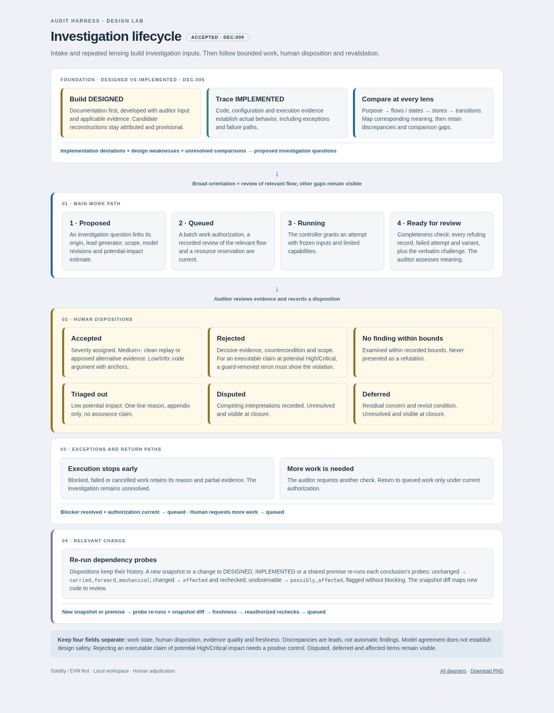
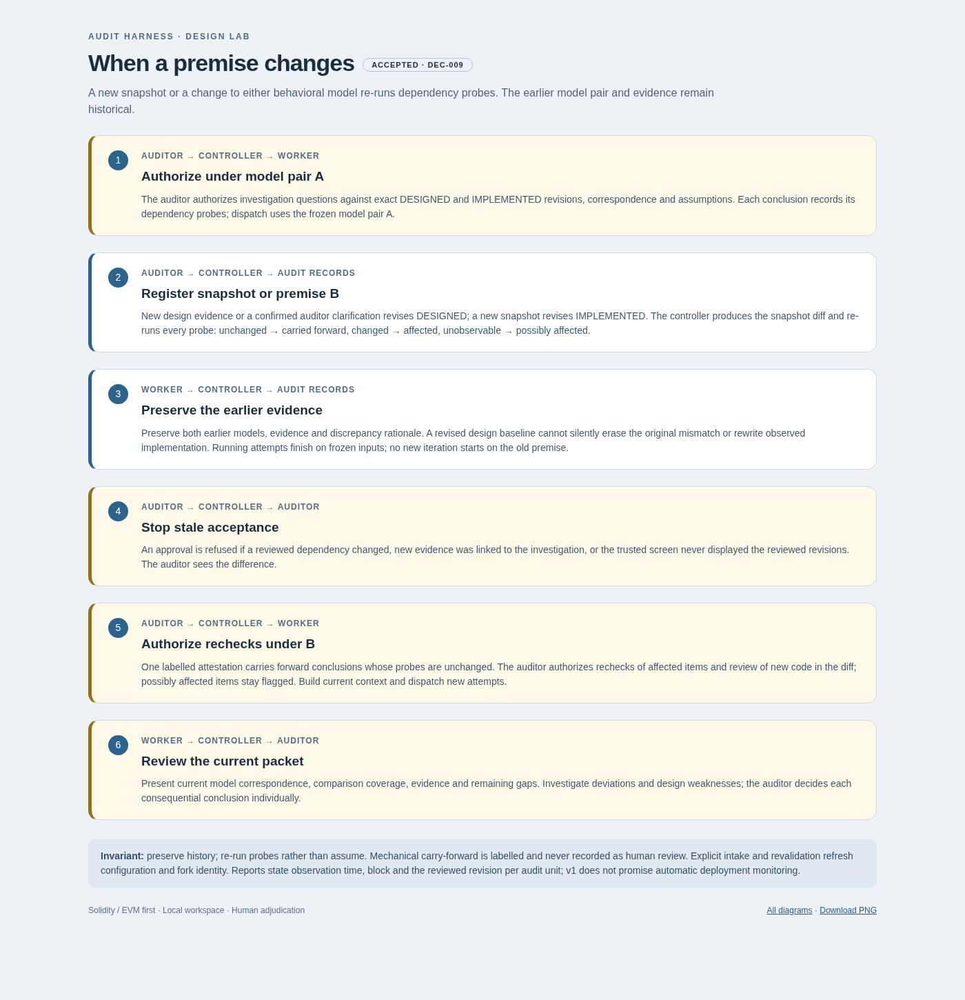

# Harness state and execution specification

Status: **[accepted baseline](harness-glossary.md#terms)**, 2026-10-12: the architecture was accepted as amended in [DEC-009](../decisions/DEC-009-architecture-acceptance-and-remaining-dispositions.md). First proposed 2026-10-01; amended 2026-10-12 to integrate [DEC-008](../decisions/DEC-008-adversarial-review-dispositions.md), DEC-009 and the [adversarial review](../research/adversarial-design-review.md)'s fixes. Companion to the [product proposal](audit-harness.md). Requirements here describe a future implementation; no harness runtime is provided in this lab. Names and allowed values follow the [glossary](harness-glossary.md).

The controller owns the audit record. Agents submit proposals and tool requests; they do not edit accepted conclusions, decision records, or the target snapshot. Historical evidence stays immutable, while its applicability to the active revision can change.

The [component and artifact contracts](harness-interface-contracts.md) define how these rules appear at requests, adapter boundaries, errors and portable exports. The [auditor guide](harness-auditor-guide.md) describes the corresponding human workflow.

## Record contracts

Every record has a stable engagement-scoped ID, type, schema version, revision, creation actor/time, originating job or human action, visibility, and explicit dependency references. Mechanism-library records use library-scoped IDs instead, and decisions about public entries, revisions and retirements are made in the library scope. References identify an exact revision or artifact hash. Display names and line numbers alone are insufficient identity. Unknown values are explicit with a reason; they do not become invented defaults.

| Record | Required content beyond common metadata |
|---|---|
| Engagement | Owner; audit purpose; ecosystem/chain; scope/exclusions; target and dependency identities; threat model, including the narrowed [default attacker charter](harness-glossary.md#terms) and the trusted-role premise; data policy, including a live-exploitable data class; disclosure constraints; severity rubric; potential-impact threshold for listing rejections in reports; budget; evidence policy; review, clarification and decision capacity settings; time plan; read-first mode start and end, when used; closure status |
| Target snapshot | Commit when available plus content hashes; dirty/untracked included files; dependencies/remappings; vendored dependencies with upstream release identity and a modified or unmodified result; effective compiler, optimizer and EVM settings; build receipt; storage layout per contract; deployed addresses, proxy implementations and configuration if claimed; fork chain/block number/hash and source retrieval provenance; snapshot diff against the prior snapshot |
| System statement | Kind: intent, observed implementation, assumption, guarantee, or unknown; model affiliation; origin; statement; source anchors; captured-input and confirmation references when the origin is `auditor_clarification`; for intent the auditor records, its derived [intent timing](harness-glossary.md#terms); applicability; supporting/contradicting evidence; review status and owner |
| Behavioral correspondence | Exact DESIGNED/IMPLEMENTED statement revisions or explicit missing side; audit unit/lens; one-to-many mapping; conditions, assumptions and abstraction limits; mapping evidence and review status |
| Behavioral comparison | Correspondence revisions; examined behavior and bounds; coverage (`missing_design`, `unexamined_implementation`, `partial` or `examined`); result (`undetermined`, `discrepancy` or `no_discrepancy_observed`); supporting/refuting evidence; uncertainty; the intent timing of the auditor intent it relies on; owner and next action |
| Behavioral discrepancy | Comparison and claim revisions; deviation or unmatched behavior; triggering conditions; evidence support and uncertainty; proposed distinguishing check; linked clarifications/investigations; human disposition and freshness separately |
| Audit unit | Kind (`flow`, `guarantee`, `boundary`, `component`, `composition`, `system_invariant`, or `upgrade_and_storage_layout`, which is mandatory for proxied systems); entry points and state writers; dependencies; risk rationale; planned methods; lead-generator coverage; auditor review coverage of in-scope functions; reviewed revision; review status; the first recorded presentation of its implemented behavior to the auditor, from which intent timing is derived; evidence, including linked variants from other investigations, and explicit gaps |
| Clarification | One unresolved issue for the auditor; conflicting facts; answer source sought; options and consequences; recommendation; owner; dependency blockers; priority; coalesced duplicates; status and next action |
| Work authorization | Kind (`intake`, `exploration`, `batch`, `revalidation` or `method_evaluation`); human decision; exact scope/model revisions; admitted investigations and methods for a batch; attacker charter reference; worker/tool capabilities; egress policy; spending, runtime, concurrency, child-task, round, retry and repair limits; validity window for a standing charter; expiry, cancellation and interrupt conditions |
| Investigation | Method; investigation question (falsifiable claim or question); origin and lead generator; audit units/guarantees; attacker capabilities within the charter; prerequisites; source anchors; potential impact, with its effective value and who set it; supporting/refuting evidence; scenario variants; [linked claims](harness-glossary.md#terms), each with its linked guarantee, supporting linked variants, potential impact with its effective value and who set it, human disposition and proof status; next check; job links; work state; human disposition; proof status separately |
| Scenario variant | Parent investigation and previous variant; the linked guarantee, for a [linked variant](harness-glossary.md#terms); causal sequence; agent-declared setup powers; expected violation and defeating condition; job links; outcome; countercondition with evidence references; dependency probes; freshness |
| Property or scenario | Intended behavior source; actors/actions; units and bounds; environmental assumptions; check oracle or impact calculation; excluded actions with reasons; fixture revision; semantic review; adequacy evidence |
| Job and attempt | Authorization and context IDs; role; input hashes; tool/model identifiers and settings; capability grants; reserved and actual resources; attempt ID, for retries of identical input only; lineage to the previous job when inputs changed; command or request manifest; execution status; result receipt. Leases and heartbeats are added once concurrent or remote workers exist |
| Evidence artifact | Content hash; producer and receipt; target/fixture/property/environment revisions; command arguments and working directory; tool version; exit status; structured result; raw output/traces; seed/corpus if relevant; start/end time; missing/truncated data; environment-sensitivity flag; positive-control link for a guard-removed rerun; limitations |
| Dependency probe | Kind (`code_hash`, `structural_query`, `storage_layout`, `config_value`, `witness_rerun` or `property_rerun`); query or target; snapshot; result digest; what the probe cannot observe |
| Captured input | Verbatim auditor input; capture-channel identity (a hook or wrapper the model cannot alter); session; time; content hash. Human-authored by construction; carries no interpretation |
| Review packet | Investigation revision; potential impact; claim and decision requested; supporting and refuting evidence; every failed attempt and every scenario variant with its outcome, with linked variants grouped by the guarantee they touch, and each linked claim with its own potential impact and a flag when its flow has no `record_flow_review` decision; challenger and author positions as verbatim artifacts; challenge independence (model and provider, shared premises); unreviewed agent statements in the dependency closure; evidence-quality fields; proposed disposition; inbound-link digest and evidence watermark computed by the controller |
| Display receipt | Record revisions the trusted decision screen rendered, or the auditor interface rendered when it shows IMPLEMENTED records or KB diagrams; screen session; time; the order in which sections were opened |
| Human decision | Decision kind (see the [component contracts](harness-interface-contracts.md#human-decision-kinds)); human actor authenticated through the trusted decision screen; reviewed revisions with their dependency digest, inbound-link digest and evidence watermark; display receipt; disposition when applicable, given separately for each linked claim, with what it requires: decisive-evidence and positive-control references for `rejected`, the bounds for `no_finding_within_bounds`, the one-line reason for `triaged_out`, the competing interpretations and distinguishing check for `disputed`, and the residual concern and revisit condition for `deferred`; potential impact for the investigation question and for each linked claim, with the reason when the auditor set one below the agent's estimate; rationale, its authorship and, when agent-drafted, the auditor's edit diff; evidence route and, for `alternative_argument`, why a runnable PoC is impractical, why the argument suffices and the remaining limits; severity and its basis when applicable; unreviewed statements accepted as conditions; time; superseded decision if any |
| Finding and fix assessment | The accepted investigation, or an accepted linked claim within an investigation together with the guarantee it affects; mechanism/prerequisites/impact; severity; evidence route; acceptance decision; applicability; client response history and severity changes; separately versioned fix commit; attack status and legitimate-behavior status; derived fix label; evidence and residual issues |
| Snapshot diff | Prior and new snapshot; changed functions, modifiers, inheritance, storage layout, dependencies and compiler settings, also compared with the deployed implementation when known; each change mapped to a fix assessment, a reviewed audit unit or an unreviewed-change gap |
| Report manifest | Exact included record/artifact revisions; report hash; the controller-computed required set, with each absent item and its audience or redaction reason; assumptions and trust premises with their dependent conclusions; accepted residual risks that apply, stated as limits; reviewed revision per audit unit; gaps/unresolved items; audience/redaction policy and disclosure-constraint check; human approval; export receipt |
| Mechanism library entry | Library-scoped ID; mechanism; counterconditions; applicability, such as component classes, standards and compiler versions; source (`public_reference` with its citation, or `transfer` with only an opaque transfer reference); for a `public_reference` entry, the admitting `record_transfer` decision; revisions and retirement, each by a `record_transfer` decision in the library scope. It contains no client code, identifiers, finding text or name of the source engagement |
| Library transfer | For a lesson, kept in its source engagement, where its `record_transfer` decision is made; for a public reference, kept in the library scope. Source lesson revision or public reference; sanitized text; for a lesson, the auditor's confirmations that client details are removed and that the client agreement allows reuse; the `record_transfer` decision; the resulting library entry |

The context manifest records prompt/template revisions, selected memories and documents, prior outputs intentionally withheld, whether a challenger's initial context excluded provisional statements on the challenged path or stripped comments and NatSpec, model/provider identifiers actually returned, and relevant configuration. Record compact reasons and tool-visible work, not a requirement to expose a model's private reasoning. If a provider cannot expose immutable model identity, record that limitation rather than promising identical future generation.

Under [DEC-007](../decisions/DEC-007-human-agent-workflow.md), agent-authored scenarios may iterate within the approved investigation question and constraints without a separate human authoring checkpoint. Derivations reference the reviewed guarantee and attacker charter; novel or changed consequential semantics require human review before dependent execution.

Under DEC-008 (Q-014), agents classify their own scenario and fixture changes and the challenger reviews the declared setup powers. The controller does not detect semantic crossings mechanically. This is an accepted residual risk, stated in the [threat model](#permissions-and-isolation).

Under DEC-009 (Q-026), a follow-up into a different guarantee that needs no new capability, permission, budget, attacker power or scope stays in the current batch as a linked variant. It uses the parent's allowance. The agent classifies the follow-up and the challenger reviews that classification, as for other scenario changes. The controller still refuses any capability, permission or budget beyond the grant, and an exhausted allowance stops the follow-up and retains it as a proposed lead. A follow-up that needs anything new, or that changes a guarantee's or check oracle's meaning, returns to `authorize_work`. The follow-up may enter a flow that has no `record_flow_review` decision. The review packet then flags its linked claims as concerning an unreviewed flow, and the follow-up never marks that flow reviewed (DEC-010, Q-027).

Each scenario variant is a record with its own outcome. Scenario, fixture and evidence iterations preserve lineage and share the parent allowance, as specified in the [loop register](harness-workflow-loops.md#loop-register). One combined review packet follows testing and agent challenge, and the controller's completeness check grants no human disposition.

DESIGNED and IMPLEMENTED are separately inspectable views over attributed system statements, not replacements for the existing statement kinds. Statements identify their model affiliation (`designed`, `implemented` or `shared`) and their origin: documented claim, auditor clarification, auditee statement, inferred candidate, adopted assumption, source analysis or execution observation. An auditor clarification derives from captured input. It becomes reviewed semantics only through a confirmation decision. An auditee's answer relayed through the auditor keeps the `auditee_statement` origin. Documentation the auditee writes during the engagement is handled like other documentation (DEC-009, Q-021). Intent the auditor records carries its intent timing; the optional expectations pre-step and read-first mode let the auditor record intent `before_walkthrough` (Q-023). Shared assumptions may support both models with explicit dependencies. Comparison and discrepancy records follow the same write, human-approval, retrieval and invalidation rules as other semantic records; agents may submit provisional records, but cannot approve consequential semantics. Both model revisions and correspondence limits must survive context construction and export.

## Shared knowledge and memory

Maintain four distinct surfaces:

1. **Raw evidence:** immutable inputs and outputs, never overwritten by summaries.
2. **Engagement knowledge:** versioned intent, implementation, assumptions, guarantees, hypotheses, and decisions. A contradiction can exist without forcing a single merged narrative.
3. **Working context:** a role-specific snapshot plus a record of what the agent actually retrieved. Semantic claims carry their status and limits into the packet.
4. **Reusable lessons:** source-linked patterns and counterconditions with applicability and review state. These guide investigation and have no approval authority. Engagement-local lessons stay in their engagement. The curated [mechanism library](harness-glossary.md#terms) holds public entries and lessons the auditor transferred through a library transfer. Engagements read its admitted entries, and only `record_transfer` decisions write it (DEC-009, Q-022).

Use keyword retrieval over IDs, symbols, flows, and mechanisms initially. Retrieve a negative example or contradiction together with the claim it qualifies. A later semantic index is a replaceable derived view and must respect engagement boundaries. Missing source anchors quarantine a lesson from consequential use.

This operational store is separate from the lab's `memory/plur/`. DEC-001 does not make PLUR the harness's authoritative evidence store. PLUR could supply a per-engagement recall adapter after schema, isolation, provenance, and host behavior are validated; that is a proposed reuse path. It cannot own finding acceptance or replace evidence. Automatic capture may create attributed provisional lessons, but does not promote them into decisions.

No automatic copying between engagements, personal stores, or the design lab. Inside the harness, reusable knowledge moves between engagements only through the mechanism library; bundle import is a separate `choose_import_destination` decision. Any reusable export out of the harness requires an auditor-selected destination, sensitivity review, and an explicit export record. Plain “private” metadata is not access control. Changes to a lesson preserve the prior version and invalidate affected derived recommendations where relevant.

## Write and approval protocol

Only the controller opens writable canonical metadata. Workers receive read snapshots and private scratch/output directories. They submit typed proposals including the base revision. The controller validates the schema, source anchors, grant, engagement identity, and expected revision before committing a record update and event atomically.

On revision conflict, retain both proposals and request rebase or human reconciliation; never silently use last-write-wins for semantic claims. Duplicate artifact submissions with the same attempt and content hash are idempotent. Root-cause clustering retains each origin and dissent; final consolidation is reviewable and reversible.

Human-only actions use the trusted decision screen, an authenticated interface inaccessible to worker processes. A structured tool result containing “approved” cannot become a decision.

At commit time, the controller compares the state the auditor reviewed with current eligible state: the exact records and dependency revisions, the inbound-link set (refuting evidence, discrepancies and clarifications linked to the investigation or its guarantee) and the evidence watermark. It also requires a display receipt showing that the screen rendered those revisions. If a material dependency changed or new linked evidence arrived, the controller rejects the stale approval, shows the difference and requests review again. A user click does not grant unbounded authority to later content.

The auditor's own words reach the record through captured input. A hook or wrapper outside the model's control records the auditor's typed input verbatim (DEC-008, Q-018). An agent may propose a structured interpretation linked to captured input. That interpretation becomes intent or an assumption only through a batched confirmation decision on the trusted screen, in which each item is confirmed, edited or rejected. An agent's paraphrase is never stored as the auditor's statement.

Each decision records who authored its rationale and, when an agent drafted it, the auditor's edit diff. Dispositions and reaffirmations are individual decisions, and the screen offers no bulk disposition or bulk reaffirmation. The one permitted aggregate is the mechanical carry-forward attestation. It covers only conclusions whose dependency probes are unchanged and is labelled as mechanical (see [invalidation](#evidence-invalidation-and-revision-changes)).

A decision's dependency closure may contain agent statements that no human has reviewed. The controller lists them, and the decision is recorded as conditional on them unless the auditor reviews them or accepts them explicitly.

Stage evidence by hashing and durably storing artifacts before making them eligible through a metadata transaction. Incomplete uploads have no eligibility. If the metadata commit fails, the unreferenced blob may be retained for later recovery; it is not a finding. Evidence receipts identify the trusted runner separately from worker-authored interpretations. Hashes detect changes; they do not prove semantic truth or defeat a compromised host administrator.

Commands the auditor runs in their own terminal enter as auditor-run artifacts. Either a thin wrapper routes them through the receipt collector, or they are imported with an explicit untrusted-receipt label. Manual work therefore joins the same evidence record without borrowing the trusted runner's provenance.

The tool broker and receipt collector run outside both the agent sandbox and the sandbox executing target code. Neither sandbox can write their executable, grant configuration, receipt channel or canonical store. The collector records the launched command/image identity, observed process outcome and output hashes through the supervisor; guest-written metadata is retained as untrusted output. This establishes provenance of execution, not the truth of the test's assertion or the completeness of its instrumentation.

## State transitions

Use separate fields for work state, disposition, evidence quality, and freshness. Combining these into one “verified” label conceals important distinctions.

[Open the HTML diagram](diagrams/investigation-lifecycle.html).

| From and trigger | Result | Authority and guard |
|---|---|---|
| New investigation | `proposed` | Agent or human may submit it; the investigation question, origin, lead generator, scope and potential-impact estimate must be explicit |
| Proposed work admitted | `queued` | Controller requires a current `batch` work authorization, a `record_flow_review` decision for the relevant flow (DEC-005) and a resource reservation |
| Queued job starts | Job `running` | Valid grant; exact input/context revisions frozen; an attempt lease once concurrent or remote workers exist |
| Running job needs a premise or cannot complete | Job `failed` or `cancelled`; investigation `blocked` when no runnable job remains; the investigation stays unresolved | Controller records a reason and partial evidence; none of this means “refuted” |
| Worker submits a review packet | `ready_for_review` | Controller checks packet completeness. Every refuting or contradicting record, failed attempt and scenario variant must be listed. The challenger and author positions must be present as verbatim artifacts when a challenge was required, and a replay receipt when executable confirmation is requested. Unreviewed agent statements in the dependency closure must be listed. The controller checks completeness, not semantic truth, and a packet may report insufficient evidence |
| Auditor requests another check | `queued` under a current authorization | Changed scope, property meaning, or permissions require an updated decision |
| Auditor adjudicates | A disposition from the [disposition table](harness-glossary.md#dispositions-and-evidence) | Human decision with rationale, rationale authorship, current dependency and inbound-link digests, and a display receipt. Each disposition's evidence requirement is enforced, including the positive control for rejecting an executable claim at potential High or Critical impact |
| A new target snapshot is registered | Probes re-run; freshness `carried_forward_mechanical`, `affected` or `possibly_affected`; snapshot diff produced | Controller re-runs dependency probes; historical dispositions are preserved; no new iteration dispatches on the old premise |
| Revalidation completed | A new decision, `reaffirmed_by_human`, or a mechanical carry-forward attestation | Controller links new evidence; the auditor decides consequential conclusions individually |

Work can be administratively `closed` after a human disposition or cancellation. Disputed, deferred, affected and possibly affected items remain unresolved and appear in closure review. Reopening creates a new work revision and preserves the earlier closure. A batch is `completed` only when every admitted job is terminal or explicitly skipped/cancelled with a reason; completed execution is not completed audit coverage.

Evidence quality is recorded through independent fields, with values from the [glossary](harness-glossary.md#value-tables): provenance, prerequisite review, adequacy (with a reason when `not_applicable`), replay, and positive control. A tool's result is separately one of `counterexample`, `no_violation_observed`, `proved_in_model`, `inconclusive`, `unsupported`, or `error`, with bounds and mode. Formal results do not erase model assumptions. No numeric LLM confidence authorizes acceptance.

## Permissions and isolation

The threat model includes:

- hostile repository files and build scripts;
- malicious retrieved material and misleading tool output;
- compromised agent behavior and accidental cross-engagement retrieval;
- fixtures that silently alter the target;
- analysis steering or suppression by target content and documentation that never requests a capability, such as a false NatSpec claim or an instruction addressed to AI auditors;
- display deception against the auditor through bidirectional-control, invisible or confusable characters;
- target behavior that differs under test;
- a self-interested auditee whose answers and documents shape the DESIGNED model;
- a library entry that still carries client details after sanitization.

Trust the local operator and controller host as the initial administrative boundary; a compromised host remains outside the claimed isolation guarantee.

**Accepted residual risk (DEC-008, Q-014).** Agents classify their own scenario and fixture changes, and only the challenger and the auditor's packet review check those classifications. A fixture that quietly grants an unapproved power is therefore caught only if one of them notices. Evaluation measures this risk; it is not presented as mitigated ([K-008](../kb/claims/K-008-unenforced-semantic-gates.md)).

**Accepted residual risk (DEC-009, Q-021).** Auditee statements carry only their origin label. Documentation the auditee writes during the engagement is handled like other documentation, there is no communications log, and known issues have no handling rule. Such documentation can mirror the code, so a comparison finds no discrepancy. A real bug filed as a known issue may go uninvestigated, and contact with the auditee that preceded a disposition change leaves no record. Evaluation measures the first of these; none is presented as mitigated.

| Capability | Proposed enforcement |
|---|---|
| Read code and documents | Mount only the selected snapshot/context; do not expose other engagements, home directories, SSH agents, or secrets |
| Compile, analyze, and test | Disposable process/container/VM boundary chosen after compatibility checks; fixed tool images; unprivileged execution; network egress denied by default except to the RPC gateway; CPU, memory, disk, time, process-count and output limits |
| Write experiment files | Per-job scratch overlay; original target read-only; the agent classifies fixture differences, and the challenger and the auditor review them before evidence acceptance (DEC-008, Q-014) |
| Install dependencies | Separate preparation action under an approved source/package policy, with pinned results; no repository-provided agent/tool configuration auto-execution |
| Call cloud AI | Dedicated provider broker outside execution workers; approved provider, data classes, context limits and purpose; the live-exploitable data class restricts providers and context further; no raw provider keys in worker environments |
| Run the agent tool | One confined instance per engagement; host memory off; transcripts kept under the engagement's retention policy; no write access to the tool's own configuration, its hooks or the capture channel; worker grants as in the other rows |
| Fetch public references | Material prefetched at intake, or exact URLs a human approved; no queries or parameters composed by agents; no private code in any query; the target's own domains treated as auditee-controlled; provenance recorded and content treated as untrusted data |
| Read or write the mechanism library | Engagements read admitted entries through the context builder, and retrieval reaches no other engagement's records. Only `record_transfer` decisions on the trusted decision screen write it; agents may propose entries and transfers. No entry names a source engagement, and the auditor's confirmations are the only check that a lesson's client details are removed (DEC-009, Q-022) |
| Read chain state | Approved archive endpoints through a method/parameter allowlist that admits only the state reads forking needs; simulation methods such as `eth_call`, `eth_estimateGas` and `debug_trace*` carrying agent-written calldata are refused upstream and run on the local fork instead; explicit chain/block binding; no signer or live transaction broadcast |
| Mutate chain state for a test | Ephemeral local fork only; local endpoint namespace distinct from upstream; bind/listen only inside the isolated environment |
| Show target content to the auditor | The trusted decision screen renders bidirectional-control, zero-width and confusable characters visibly; ingestion flags instruction-like text addressed to AI or auditors as suspicious content for the intake review |
| Approve or export | Trusted decision screen; scoped report audience/destination and preview; disclosure constraints checked for unfixed findings; unavailable to agent workers |

MCP may carry requests but supplies neither these permissions nor sandbox isolation. Shell requests use structured arguments and validated paths; path traversal, symlink escapes, archive extraction and executable report content are checked at ingestion. Disable unrestricted FFI and inherited tool configuration; allow a needed exception only through a capability change. Output displayed in reports is escaped and cannot run scripts or issue commands.

Upstream RPC access must enforce allowed read methods and bounded requests, not merely allow a hostname; redirects and alternate endpoints cannot bypass policy. Local test funding and impersonation are permitted fixture operations. The agent declares their use, and the challenger and the auditor review it against attacker realism (DEC-008, Q-014). Allowed inference egress is likewise limited by approved engagement data classes and context construction, not merely a provider domain. Credentials used by brokers have scoped roles and stay out of logs/exported manifests.

Each engagement chooses retention and backup policy at intake. Back up metadata, artifacts, tool manifests and decisions together through a consistent snapshot, including required journal state. Restore into an isolated location and verify references/hashes before resuming. A corrupt store stops writes and preserves the damaged material; deleting it and restarting is not recovery. Expired material is removed only through the recorded retention workflow, with dependent records marked unavailable and no claim that deleted evidence remains replayable.

## Durable jobs and resource limits

**Walking skeleton first (DEC-008, Q-020).** The first build is one local process that runs jobs one at a time as child processes it owns. Pause and cancel terminate the process group. Records are append-only, Git-backed and validated against schemas. Evidence files are hash-pinned, and receipts come from the trusted runner. The mechanisms below that exist for concurrency, remote execution or long-lived services are added only when an observed failure or need justifies them, following the [deferral table](#deferred-mechanisms) at the end of this section. Provider calls can time out even in the skeleton, so `outcome_unknown` accounting applies from the start.

A logical job has immutable input identity and one or more attempts; an attempt retries identical input. A fixture repair or any other input change creates a new job, linked to the previous one by lineage. The controller reserves the maximum permitted model/compute/runtime allocation before dispatch, issues an attempt lease and limited capability, and persists the dispatch intent. A runner reports heartbeat, progress, receipt, and output identity. Completion commits once for that attempt; duplicate receipts do not create new findings or charges in accounting.

If the controller restarts, reconcile dispatch intent with runner receipts before retrying. If a worker lease expires, fence its later writes and revoke capabilities; preserve late output as historical material pending reconciliation. Stop the worker or establish that it has terminated before admitting a replacement that could exceed concurrency/resource limits. A pause or cancellation stops new dispatch, revokes grants as appropriate, terminates process descendants, and retains partial artifacts. Resumption validates scope, policy, and input freshness again.

Tool jobs may retry transient transport/startup failures inside the authorized retry budget. A reproducible compiler failure should generate a diagnosis, not an unbounded retry. Test repair is limited to the generated fixture and retains every diff. Changing assertion meaning, input domains, attacker powers, mocks, or source logic requires new semantic review. Suggested initial repair limit: two repair jobs per scenario variant, a pilot parameter.

Cloud request timeouts may leave cost/outcome uncertain if the provider offers no idempotency or retrieval API. Record `outcome_unknown`, preserve the reservation, and reconcile if possible; any allowed replacement consumes another conservative reservation. A local ledger cannot guarantee exactly-once provider billing. Never silently retry beyond the cap. Report estimated, confirmed and uncertain spending separately.

Long fuzzing jobs checkpoint portable corpora and logs when supported. If an engine cannot resume safely, mark the limitation and start a new attempt from a documented state when authorized. A seed alone does not guarantee reproducibility across engines, tool versions, hardware scheduling or fork providers. Canonical replay uses the minimized explicit sequence and its environment manifest.

### Deferred mechanisms

The walking skeleton defers these mechanisms. Each one is added with a record of the failure or need that justified it.

| Mechanism | Added when |
|---|---|
| Attempt leases, heartbeats and fencing of late writes | Concurrent or remote workers are introduced |
| Idempotency records with retention | A client retries mutating requests over a transport that can lose responses |
| Monotonic event cursors and `snapshot_required` | More than one process consumes controller events |
| Contract-version migration | The first schema change after records exist for a real engagement |
| Journal-consistent backup of a transactional store | A transactional database replaces Git-backed records |
| Remote or parallel workers | Workloads exceed one workstation or the one-job-at-a-time limit |

Until then, the skeleton gets the properties these mechanisms protect in simpler ways. Git history and content hashes provide integrity and backup. Process-group termination provides stopping. One-at-a-time execution means no concurrent work can exceed a limit.

## Evidence invalidation and revision changes

Dependencies include code symbols/files, resolved call targets, proxy implementations, library versions, compiler/EVM settings, deployment config, fork block, intended behavior, assumptions, properties, fixtures, and relevant analysis rules. A model/prompt update alone does not invalidate immutable tool evidence; it can make agent-derived interpretations due for review.

On a revision change, register a new snapshot, produce its snapshot diff and re-run the dependency probes recorded with each consequential conclusion (DEC-008, Q-019). Those conclusions include refutations, scenario-variant outcomes, coverage claims, accepted findings, fix assessments, comparisons, diagrams and pending approvals. Each conclusion then gets one of these freshness values:

| Freshness | When | What happens |
|---|---|---|
| `carried_forward_mechanical` | Every probe is unchanged | The conclusion is carried forward. Before closure or export, the auditor records one `attest_carry_forward` decision covering the carried set |
| `affected` | A probe changed | The conclusion is listed for recheck under a `batch` authorization at stage 04 |
| `possibly_affected` | A probe cannot be evaluated, or the conclusion has dependencies no probe observes | The conclusion is flagged; work is not blocked |
| `reaffirmed_by_human` | The auditor decides it individually | The conclusion holds by that decision |

Queued work that depends on affected conclusions is suspended. Running attempts finish against their frozen inputs, but no new iteration is dispatched on the old premise, and nothing is promoted automatically into the current snapshot. Old evidence and decisions are preserved as valid historical records about their exact inputs. All PoCs and properties are rerun automatically on the new snapshot, within the engagement's `revalidation` authorization; reruns beyond that allowance wait for authorization.

Probes are themselves incomplete. An unresolved dynamic call, assembly, a missing edge, an unknown configuration influence or an unexplained analysis mismatch makes the affected conclusions `possibly_affected`. The report lists those conclusions together with what their probes cannot observe. “No changed probe” is not proof of irrelevance. Mechanical carry-forward is therefore a single labelled attestation, shown in the report, that covers only conclusions whose probes are unchanged; it is never recorded as human review.

Review each revision forward from its diff as well as backward from old conclusions. The snapshot diff lists changes to functions, modifiers, inheritance, storage layout, dependencies and compiler settings. It compares against the previous snapshot and, when known, the deployed implementation. Every change maps to a fix assessment, a reviewed audit unit or an unreviewed-change gap, which is printed beside the fix status. For proxied systems, upgrade and storage-layout safety is a mandatory audit unit, and storage layouts are compared across every snapshot.

[Open the HTML diagram](diagrams/premise-change-flow.html). No automatic monitoring of live deployments is promised in v1. Refresh external configuration and fork identity at explicit intake/revalidation points; reports state their observation time and block, and the reviewed revision for each audit unit. A later source or deployment revision is not covered until reviewed.

## Replay and semantic validity

A clean replay uses a fresh worker with no generating-agent scratch state, exact target identity, separate reviewed fixtures, locked dependencies/tool versions, explicit sequence, and pinned fork state if required. Check source/artifact hashes and deployed bytecode/implementation identity before making deployment-specific claims. Missing archive data, unresolved library links or source-bytecode mismatch blocks that claim, while source-only analysis can continue with a limitation. A PoC package captures the fork state the PoC touches (accounts, code and storage slots), so replay does not depend on an archive provider still serving that state. The archive reference is kept as provenance.

The auditor or challenger reviews provisioning, role impersonation, time jumps, mocks, storage edits and environmental assumptions. Attacker actions must be separated from setup conveniences. Review the final committed state, not only an intermediate trace. Measure impact through a stated check oracle, including costs and liabilities when economics matter.

Target code can behave differently under test. Flag environment reads that feed branches deterministically: `tx.origin`, `block.coinbase`, `block.basefee`, `block.chainid`, the gas price, and code at fixed addresses such as the cheatcode address. Replay with realistic values. A negative result that depends on those reads is labelled environment-sensitive.

A failing test can indict its fixture. A passing PoC assertion can demonstrate a vulnerability. The evidence record therefore states the expected property, observed violation, and interpretation separately from exit status. A critical property also needs an adequacy challenge, such as a reviewed reachable fault or another justified sensitivity check. Noncompiling mutants and irrelevant failures do not count as evidence that the property detects a defect.

A refutation needs its own control. When an executable claim with potential High or Critical impact is refuted, rerun the same fixture against a disposable copy with the cited guard removed. The rerun must show the violation. Otherwise the positive control is `no_violation`, and the refutation can support neither `rejected` nor `no_finding_within_bounds` (DEC-008, Q-016). This catches a PoC that failed for an unrelated reason, such as a setup error, a wrong address or a reverted precondition.
