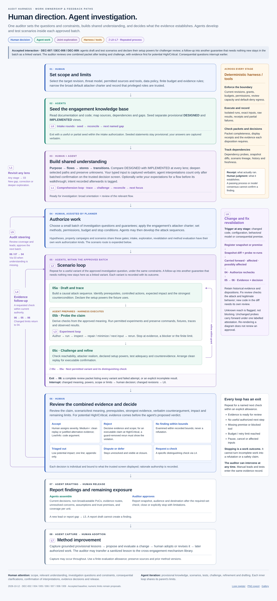

# Human and agent workflow: ownership and loops

Status: **DEC-007 interaction choices accepted; detailed loop contracts in the [accepted baseline](harness-glossary.md#terms)**, 2026-10-02. This elaborates the existing [product](audit-harness.md), [auditor guide](harness-auditor-guide.md) and [state contract](harness-state-and-execution.md). The architecture was accepted as amended in [DEC-009](../decisions/DEC-009-architecture-acceptance-and-remaining-dispositions.md) (Q-008). [Source analysis and issue triage](../research/flow-diagram-review.md) preserve the reasoning. Amended 2026-10-12 for [DEC-008](../decisions/DEC-008-adversarial-review-dispositions.md) and DEC-009; names and allowed values follow the [glossary](harness-glossary.md).

[Open the standalone HTML diagram](diagrams/human-agent-audit-flow.html).

## Work ownership

“Joint” means an interactive activity with distinct responsibilities. It does not grant an agent decision authority. Manual auditor analysis, scenarios and tests may enter at any stage through the same evidence records.

| Stage | Human auditor | Agent work | Deterministic harness | Handoff |
|---|---|---|---|---|
| 01 · Scope and limits | Select revision/scope, threat model, permitted sources/tools/providers, budget and evidence policy; narrow the default attacker charter and confirm the trusted-role premise; review the deterministic inventory, the vendored-dependency results and the project test-suite run | Suggest missing inputs and explain consequences | Pin inputs, grants and limits; derive the inventory from compiler artifacts; check vendored dependencies against upstream releases; run the project's tests with coverage | Authorized intake (`accept_scope_and_policy` and an `intake` work authorization) with explicit gaps |
| 02 · Seed knowledge | Answer consequential clarifications when needed | Extract provisional DESIGNED/IMPLEMENTED views, source links and proposed explorations under the `intake` work authorization | Record build/analysis outcomes and revisions | Provisional KB and gaps; L0 can repeat within the intake allowance |
| 03 · Joint lensing | Understand the selected flow; optionally record expectations before its walkthrough (the expectations pre-step); supply intent, correct consequential assumptions, choose depth; confirm, edit or reject agent interpretations in batches on the trusted decision screen | Guide purpose → flows → stores → transitions; trace and compare both models, preserve disagreements; propose structured interpretations linked to captured input | Capture the auditor's typed input verbatim outside the model; derive each intent statement's timing (`before_walkthrough` or `after_walkthrough`); keep linked models/diagrams and sources current | Broad orientation plus a recorded review of the relevant flow; L1 remains available throughout |
| 04 · Authorize work | Approve investigation questions, semantic constraints, the attacker charter, capabilities, finite budget and stop conditions; optionally approve a standing charter for recurring local work under explicit ceilings | Rank leads, report lead-generator coverage, include at least one high-value multi-step or cross-flow question, suggest methods and expected evidence | Admit only work within a current `batch` work authorization whose relevant flow has a recorded review | Version-bound work authorization; no required human scenario-authoring step |
| 05 · Investigate | Remain available for consequential clarifications; optionally add manual work | Draft/trace scenarios, declare each variant's setup powers, prepare experiment probes, investigate properties or hypotheses, challenge and refine; follow an effect on another guarantee as a linked variant when it needs nothing new; the challenger reviews the declared setup powers | Run permitted tools, collect receipts, record each scenario variant with its outcome, enforce limits and freshness | A complete review packet listing every variant and failed attempt, with linked variants grouped by the guarantee they touch, or an explicit incomplete packet |
| 06 · Review and decide | Review scenario/test meaning, prerequisites, adequacy, evidence, impact and severity; choose `accepted`, `rejected`, `no_finding_within_bounds`, `triaged_out`, `disputed` or `deferred`, or request more work; decide each item individually, including each linked claim at its own potential impact, never in bulk | Present the packet with the challenger's and author's positions verbatim, limits and a proposed disposition; for potential High/Critical decisions the proposed disposition is revealed only after the evidence | Check packet completeness, evidence requirements by potential impact, display receipts and current decision inputs | Human disposition or L4 follow-up; next batch is L5 |
| 07 · Report and close | Review unresolved exposure, scope limits, and the assumptions and trust premises; give a reason for each required item the selection omits; approve exact report/audience/destination; close or stop explicitly | Draft narrative from current decisions; assemble reproducible packages and limitations | Compute the required set; generate the scope, coverage, unresolved-item, assumption, accepted-residual-risk and structured finding sections from records; freeze the manifest and export approved content | Report plus non-broadcastable PoC tests or labelled, approved alternative evidence |
| 08 · Learn and improve | Review useful lessons and decide whether evaluated method changes should be adopted; decide each proposed transfer of a sanitized lesson to the mechanism library with `record_transfer` | Capture grounded provisional lessons, identify recurring failures and propose improvements and library transfers | Preserve source lineage and workflow versions; keep each lesson's transfer record in its source engagement | L7 proposal, adopted method revision or admitted library entry for later authorized work |

## Loop register

Every iteration records its loop/stage, parent investigation or exploration, exact input revisions, next check and reason, remaining allowance, output/evidence delta and exit reason. All loops stop dispatching new iterations on cancellation or exhausted allowance. When a premise becomes `affected`, running attempts finish against their frozen inputs, but no new iteration is dispatched on the old premise. A parent's allowance bounds its inner iterations, and starting a new inner loop does not reset it. Inner L2 and L3 iterations within the same investigation, including linked variants, are not child tasks, so the child-task limit does not apply to them. Numerical limits are explicit engagement or work-authorization settings, not universal defaults.

| ID and diagram label | Entry and owner | Repeated process and return | Exit / escalation | Persisted result |
|---|---|---|---|---|
| **L0 · Intake rounds** | 02; agents under an approved intake allowance | Seed → inspect missing connections/contradictions → reconcile a KB delta → another named seed task at 02 | Useful or partial seed; no justified next task; round/budget cap; consequential missing premise. Human exploration may start with a partial seed | Attributed provisional knowledge, source/revision links, unresolved gaps and exploration suggestions |
| **L1 · Comprehension loop** | 03 or a gap from any later stage; joint human/agent | Orient → trace → challenge → reconcile → explain → optional checkpoint → choose another lens/depth at 03 | Current objective understood at chosen depth; pause/redirect; missing evidence or semantic decision. Investigation needs broad orientation and its relevant reviewed flow, not all-system completion | DESIGNED/IMPLEMENTED comparisons, state diagrams, reviewed semantics, gaps and next focus |
| **L2 · Scenario loop** | 05a after 04; agents within an approved investigation question, including linked variants that follow an effect on another guarantee and need nothing new (DEC-009, Q-026) | **05a draft and trace → 05b probe → 05c challenge → refine the next permitted variant at 05a**. Each variant is a record with its outcome: `supports`, `refuted`, `inconclusive`, `blocked`, `stress_assumption` or `abandoned`. L3 runs inside 05b | Ready for review: a supported candidate, a scoped refutation, or an exhausted investigation question whose packet supports `no_finding_within_bounds`. Also exits when no useful authorized next check remains, or on budget or a blocker. A follow-up that needs a new capability, permission, budget, attacker power or scope, or that changes a guarantee's or check oracle's meaning, goes to 04 as a proposed investigation question; a changed consequential premise goes to a clarification or to 03; the review packet, listing every variant, goes to 06 | Scenario lineage, variant outcomes, linked guarantees, declared setup powers within the attacker charter, expected/observed effects, counterconditions and accumulated evidence |
| **L3 · Experiment loop** | 05b; agent plus execution tools | Author fixture/property → execute → inspect → repair fixture, minimize witness or choose next permitted search input → rerun at 05b. A retry of identical input is another attempt of the same job; a repair or new input is a new job linked by lineage | Useful result for 05c; a finite search, time or per-variant repair cap; reproducible failure; semantic change. A failing security assertion may be evidence, not a defect to “repair” | Every fixture diff, command/input, seed/sequence, raw result, receipt, bound and adequacy note |
| **L4 · Evidence follow-up** | 06; human requests a distinguishing check | 06 → 05a/05b/05c as relevant → updated combined packet → 06 | An auditor disposition (including `deferred`), blocked work, or an exhausted grant. Reauthorize changed investigation questions or limits; do not ask again for an unchanged, still-authorized check | Requested check, new evidence and a current review packet |
| **L5 · Audit steering** | 06, a proposed new lead, or report-gap review at 07; human selects work | Reconcile coverage/leads → 03 if understanding is missing → **04 authorize the next small batch → 05 → 06** | Explicit closure with limitations, pause or budget end. Agent discovery cannot self-approve the next batch | Coverage/gap update, ranked backlog and new `batch` work authorization |
| **L6 · Change and fix revalidation** | A source, configuration, behavioral-model or premise change from any stage; harness detects, agents analyze, human judges. An AI-model change alone makes agent-derived interpretations due for review but does not invalidate tool evidence | `register_snapshot` → snapshot diff and dependency-probe re-runs → freshness `carried_forward_mechanical`, `affected` or `possibly_affected` → 02/03 where understanding is affected → 04 authorize rechecks → 05 gather evidence → 06 new decision. Review also proceeds forward from the diff: every change maps to a fix assessment, a reviewed audit unit or an unreviewed-change gap | Each affected conclusion is rechecked and decided individually, or left explicitly unresolved or not assessed. Unchanged-probe conclusions are carried forward under one `attest_carry_forward` decision, labelled mechanical, and `possibly_affected` items are flagged without blocking. Scoped fix review records attack status and legitimate-behavior status separately | New snapshot and behavioral-model versions, snapshot diff, probe results, retained historical evidence/dispositions, and revised freshness and fix assessment |
| **L7 · Method improvement** | Lessons from any stage, summarized at 08; agents capture, human owns adoption | Ground lesson → propose workflow/check/retrieval change → evaluate under an approved `method_evaluation` authorization → human adoption (`adopt_method_version`) or revision → later authorized work | Adopted version, rejected proposal or deferred evaluation; a finite improvement allowance. No automatic live workflow change or cross-engagement transfer; a lesson reaches the mechanism library only through a `record_transfer` decision (DEC-009, Q-022). Adoption follows the evaluation plan's held-out comparison (DEC-009, Q-024) | Lesson with counterconditions, evaluation record and versioned adoption/rollback rationale |

Loop IDs label process repetition, not EVM state-machine transitions, job states or evidence strength. Per-contract and per-finding repetition in the imports becomes traversal of selected audit units/investigations under L5, with L2/L3 inside them. Fuzzing search, PoC repair and minimization are different modes of L3; clean replay is a validation step, and a failed replay returns for diagnosis rather than running until green. Controller recovery/retry mechanics stay in the [execution contract](harness-state-and-execution.md#durable-jobs-and-resource-limits); they do not create a new security hypothesis.

## The scenario loop in detail

The auditor approves an investigation question and its constraints, including the engagement's attacker charter, not every generated attack sequence. Under [DEC-007](../decisions/DEC-007-human-agent-workflow.md), agents may draft and test sequences autonomously within those premises. Each candidate is a scenario variant that connects a potential failure to a complete causal path: initial state, attacker-controlled inputs/actions, relevant victim/privileged actions, transitions, settlement and impact. Record capital, liabilities and timing when relevant; availability failures need no profit premise.

Before a probe, state the expected violation and the condition that would defeat the claim. Derive its check from reviewed guarantees and constraints. A novel success criterion, an attacker power beyond the engagement's charter or a changed check-oracle meaning needs a focused clarification; syntactic fixture repair does not. Agents make that classification and declare each variant's setup powers, and the challenger reviews both. The controller does not detect such crossings mechanically (DEC-008, Q-014); this is an accepted residual risk. The controller records observed execution, and the agent interprets it provisionally. Neither a process exit code nor repeated agreement establishes a finding.

After the probe, challenge prerequisites, reachability, fixture behavior, final committed state, counterevidence and sensitivity. Another iteration names what changes and what evidence that change should distinguish. A new test input or action order may be inside the current investigation question. A follow-up into a different affected guarantee stays in the current batch as a [linked variant](harness-glossary.md#terms) when it needs no new capability, permission, budget, attacker power or scope (DEC-009, Q-026). It may enter a flow without a `record_flow_review` decision, and the packet then flags its claims as concerning an unreviewed flow (DEC-010, Q-027). It uses the parent's allowance; when that runs out, the follow-up stops and is retained as a proposed lead. The agent classifies the follow-up and the challenger reviews it, as for other scenario changes, and the controller still refuses any capability, permission or budget beyond the grant. A follow-up that needs anything new, or that changes a guarantee's or check oracle's meaning, returns to `authorize_work` as a proposed investigation question. Ambiguity is exposed rather than silently broadening the grant. Each variant's outcome is recorded. The review packet lists every variant, including refuted and abandoned ones, with its countercondition. It groups linked variants by the guarantee they touch, and each [linked claim](harness-glossary.md#terms) gets its own potential impact and disposition in the same review.

The default human review is one combined packet after testing and agent challenge. It includes a clean replay whenever executable confirmation is requested. For potential High/Critical decisions, the packet shows the evidence and the challenger's verbatim counterargument before the proposed disposition. A consequential uncertainty interrupts as soon as it matters. An impractical PoC can instead lead to the documented alternative-evidence request allowed by DEC-004, with the full attempt history attached.

Lack of further progress produces a packet that supports `no_finding_within_bounds`, or an unresolved result; it never produces an automatic rejection or a safety claim. Rejecting an executable claim with potential High or Critical impact also needs a positive control, as defined in the [disposition table](harness-glossary.md#dispositions-and-evidence).

## Interruption and return rules

| Trigger | Immediate action | Return |
|---|---|---|
| A guarantee, intent or check-oracle meaning is missing or changed, or an attacker capability goes beyond the engagement's attacker charter | Ask one focused clarification with evidence, alternatives and affected work; suspend dependent work only | Human clarification and refreshed semantic or work authority; L1 if understanding needs revision |
| Clarification queue full | Hold lower-priority clarifications without dropping them, coalesce duplicates and present blocking clarifications first | Unrelated work continues; an answered clarification releases its dependent work |
| New investigation question, scope, provider/tool permission or budget | Retain a proposed lead/change; request the specific boundary decision. A follow-up into another guarantee that needs none of these continues as a linked variant (DEC-009, Q-026) | 04; only current authorized work executes |
| Changed source, deployment configuration or behavioral-model revision | Register a snapshot, re-run dependency probes and suspend work that depends on `affected` conclusions; retain old artifacts and stop promotion to the current revision | L6; never relabel old evidence as current |
| Run failure, transient tool error or generated-fixture defect | Diagnose and retry only within the permitted L3/recovery bound, preserving meaning and diffs | 05b or incomplete packet at 06 |
| Credible urgent concern | Prompt human attention with evidence and known limits | Human steering; urgency supplies no extra permissions. There is no urgent release path: any urgent contact with the client happens outside the harness, the full frozen export is the only release path, and the harness keeps no record of the contact (DEC-009, Q-025) |
| Budget exhausted, review queue full, cancellation or no useful next check | Stop new dispatch and preserve partial work/uncertain cost; reconcile in-flight work | Explicit unresolved/paused state, 06 review or a new authorized allocation |

## Synthetic walkthrough

The approved investigation question is whether a withdrawal queue can let an ordinary user receive more assets than the reviewed entitlement. The engagement narrows the default attacker charter by excluding flash-loan capital. The attacker keeps the other default powers: public calls, multiple accounts and attacker contracts, ordering within a block, oracle-update timing within the feed's rules, griefing spend and permitted token callbacks; the target revision and budget are fixed.

Agents draft a first variant, trace the queue and choose an accounting check derived from that guarantee (**L2**). They repair an incorrect generated import path, which creates a new job linked by lineage, and rerun the fixture (**L3**). A challenger identifies a callback guard missing from the explanation. The first variant is recorded as `refuted`, with that guard as its countercondition, and agents try another permitted order as a second variant (**L2**).

A third proposal requires administrator impersonation to claim a permissionless attack. Agents declare the changed capability before relying on it, and the challenger reviews the declaration. The variant can be kept with outcome `stress_assumption`, but it cannot support the original claim. The auditor receives the combined packet, which lists all three variants, and can request one missing settlement check (**L4**) or select a different approved investigation question (**L5**).

A later patch is registered as a new snapshot. The snapshot diff shows the changed withdrawal path, and dependency probes mark the refuted variant and the related coverage claim `affected`. Attack and legitimate-withdrawal checks follow, with attack status and legitimate-behavior status recorded separately (**L6**). A lesson about checking final settlement may be captured provisionally; changing the standing method follows **L7**. This invented example illustrates routing, not a finding or an executed test.
